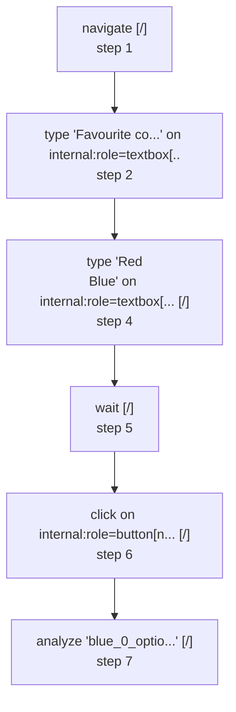

# DAG Action Graph

## Node Legend

| ID | Signature | First Seen |
|-----|-----------|------------|
| N0 | `http://localhost:38033/\|navigate\|\|none` | step 1 |
| N1 | `http://localhost:38033/\|type\|Favourite colour?\|internal:role=textbox[name="Question"i]` | step 2 |
| N2 | `http://localhost:38033/\|type\|Red
Blue\|internal:role=textbox[name="Options, one per line"i]` | step 4 |
| N3 | `http://localhost:38033/\|wait\|\|none` | step 5 |
| N4 | `http://localhost:38033/\|click\|\|internal:role=button[name="Create poll"i]` | step 6 |
| N5 | `http://localhost:38033/\|analyze\|blue_0_option_result\|none` | step 7 |
