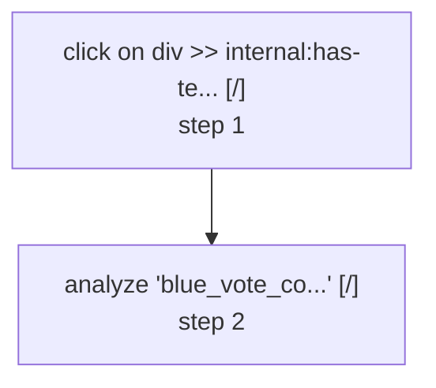

# DAG Action Graph

## Node Legend

| ID | Signature | First Seen |
|-----|-----------|------------|
| N0 | `http://localhost:42825/\|click\|\|div >> internal:has-text="Blue (0)Vote"i >> internal:role=button\|ctx:Create poll` | step 1 |
| N1 | `http://localhost:42825/\|analyze\|blue_vote_count_display\|none` | step 2 |
