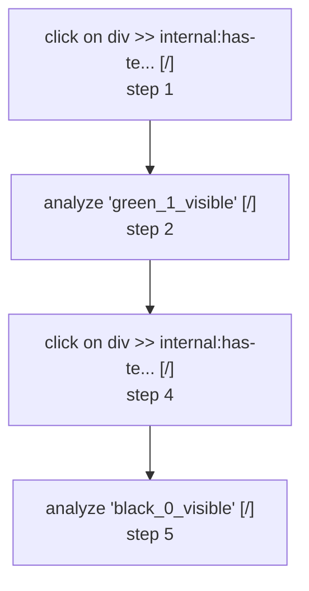

# DAG Action Graph

## Node Legend

| ID | Signature | First Seen |
|-----|-----------|------------|
| N0 | `http://localhost:38501/\|click\|\|div >> internal:has-text="Green (0)Vote"i >> internal:role=button\|ctx:Create poll` | step 1 |
| N1 | `http://localhost:38501/\|analyze\|green_1_visible\|none` | step 2 |
| N2 | `http://localhost:38501/\|click\|\|div >> internal:has-text="Black (0)Vote"i >> internal:role=button` | step 4 |
| N3 | `http://localhost:38501/\|analyze\|black_0_visible\|none` | step 5 |
