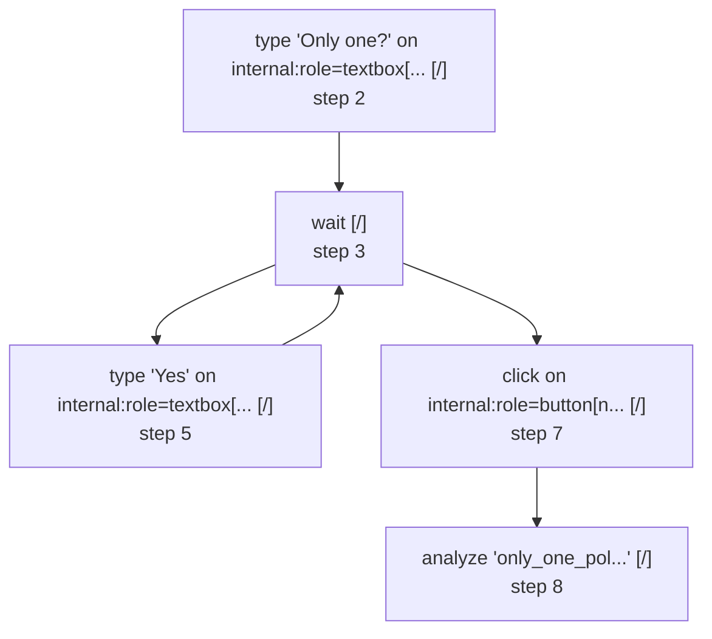

# DAG Action Graph

## Node Legend

| ID | Signature | First Seen |
|-----|-----------|------------|
| N0 | `http://localhost:41821/\|type\|Only one?\|internal:role=textbox[name="Question"i]` | step 2 |
| N1 | `http://localhost:41821/\|wait\|\|none` | step 3 |
| N2 | `http://localhost:41821/\|type\|Yes\|internal:role=textbox[name="Options, one per line"i]` | step 5 |
| N3 | `http://localhost:41821/\|click\|\|internal:role=button[name="Create poll"i]` | step 7 |
| N4 | `http://localhost:41821/\|analyze\|only_one_poll_in_list\|none` | step 8 |
