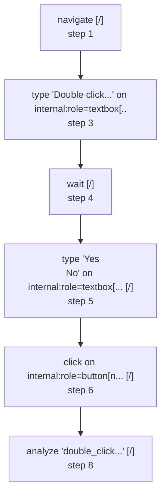

# DAG Action Graph

## Node Legend

| ID | Signature | First Seen |
|-----|-----------|------------|
| N0 | `http://localhost:42417/\|navigate\|\|none` | step 1 |
| N1 | `http://localhost:42417/\|type\|Double click once?\|internal:role=textbox[name="Question"i]` | step 3 |
| N2 | `http://localhost:42417/\|wait\|\|none` | step 4 |
| N3 | `http://localhost:42417/\|type\|Yes
No\|internal:role=textbox[name="Options, one per line"i]` | step 5 |
| N4 | `http://localhost:42417/\|click\|\|internal:role=button[name="Create poll"i]` | step 6 |
| N5 | `http://localhost:42417/\|analyze\|double_click_once_poll_count_check\|none` | step 8 |
