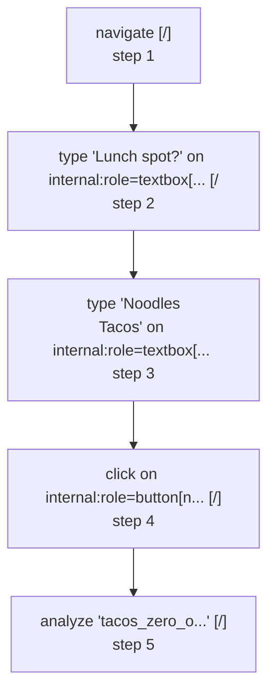

# DAG Action Graph

## Node Legend

| ID | Signature | First Seen |
|-----|-----------|------------|
| N0 | `http://localhost:43523/\|navigate\|\|none` | step 1 |
| N1 | `http://localhost:43523/\|type\|Lunch spot?\|internal:role=textbox[name="Question"i]` | step 2 |
| N2 | `http://localhost:43523/\|type\|Noodles
Tacos\|internal:role=textbox[name="Options, one per line"i]` | step 3 |
| N3 | `http://localhost:43523/\|click\|\|internal:role=button[name="Create poll"i]` | step 4 |
| N4 | `http://localhost:43523/\|analyze\|tacos_zero_option_visible\|none` | step 5 |
