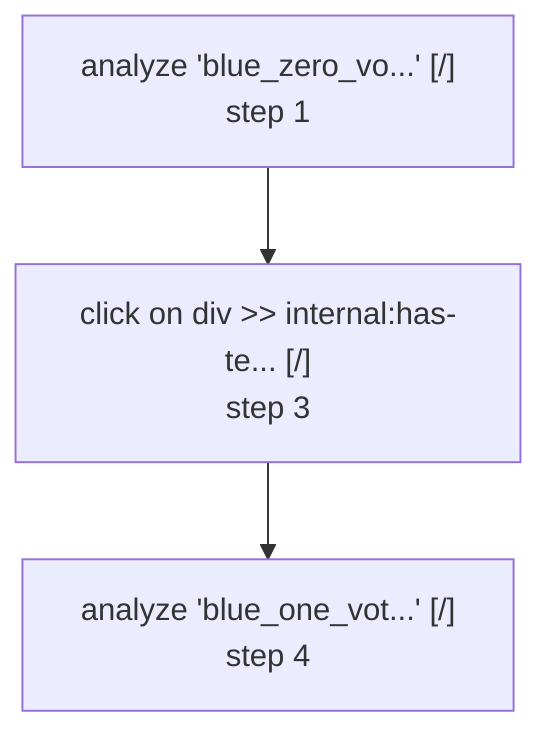

# DAG Action Graph

## Node Legend

| ID | Signature | First Seen |
|-----|-----------|------------|
| N0 | `http://localhost:33389/\|analyze\|blue_zero_vote_count\|none` | step 1 |
| N1 | `http://localhost:33389/\|click\|\|div >> internal:has-text="Blue (0)Vote"i >> internal:role=button` | step 3 |
| N2 | `http://localhost:33389/\|analyze\|blue_one_vote_count\|none` | step 4 |
