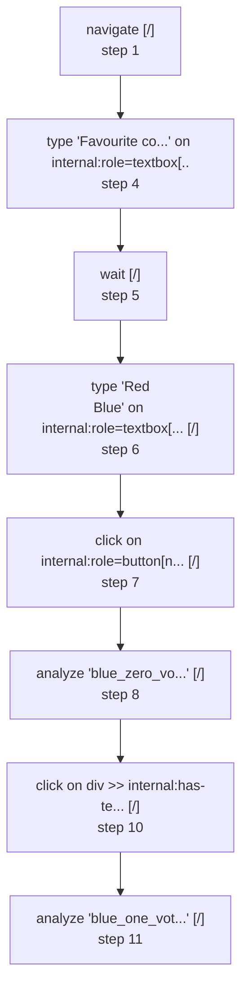

# DAG Action Graph

## Node Legend

| ID | Signature | First Seen |
|-----|-----------|------------|
| N0 | `http://localhost:39625/\|navigate\|\|none` | step 1 |
| N1 | `http://localhost:39625/\|type\|Favourite colour?\|internal:role=textbox[name="Question"i]` | step 4 |
| N2 | `http://localhost:39625/\|wait\|\|none` | step 5 |
| N3 | `http://localhost:39625/\|type\|Red
Blue\|internal:role=textbox[name="Options, one per line"i]` | step 6 |
| N4 | `http://localhost:39625/\|click\|\|internal:role=button[name="Create poll"i]` | step 7 |
| N5 | `http://localhost:39625/\|analyze\|blue_zero_vote_count\|none` | step 8 |
| N6 | `http://localhost:39625/\|click\|\|div >> internal:has-text="Blue (0)Vote"i >> internal:role=button` | step 10 |
| N7 | `http://localhost:39625/\|analyze\|blue_one_vote_count\|none` | step 11 |
