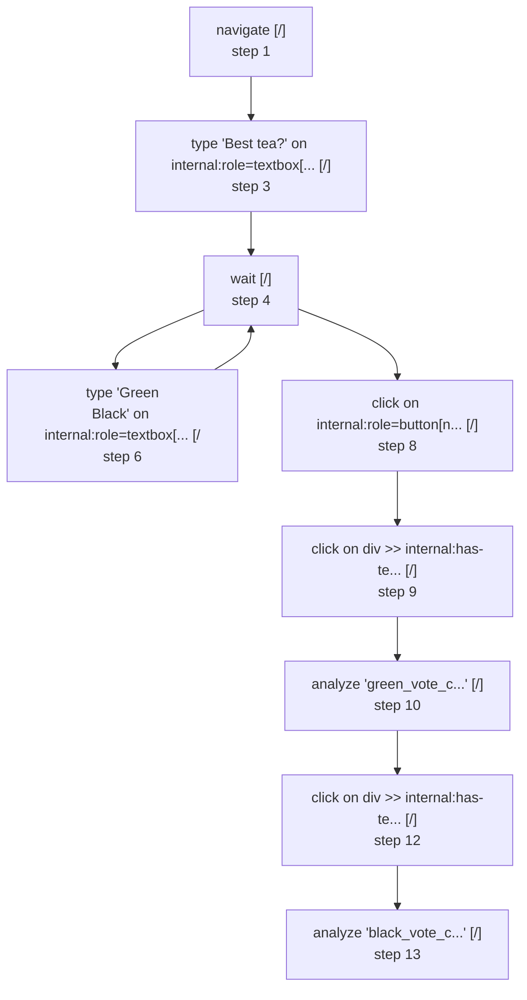

# DAG Action Graph

## Node Legend

| ID | Signature | First Seen |
|-----|-----------|------------|
| N0 | `http://localhost:42755/\|navigate\|\|none` | step 1 |
| N1 | `http://localhost:42755/\|type\|Best tea?\|internal:role=textbox[name="Question"i]` | step 3 |
| N2 | `http://localhost:42755/\|wait\|\|none` | step 4 |
| N3 | `http://localhost:42755/\|type\|Green
Black\|internal:role=textbox[name="Options, one per line"i]` | step 6 |
| N4 | `http://localhost:42755/\|click\|\|internal:role=button[name="Create poll"i]` | step 8 |
| N5 | `http://localhost:42755/\|click\|\|div >> internal:has-text="Green (0)Vote"i >> internal:role=button` | step 9 |
| N6 | `http://localhost:42755/\|analyze\|green_vote_count_visible\|none` | step 10 |
| N7 | `http://localhost:42755/\|click\|\|div >> internal:has-text="Black (0)Vote"i >> internal:role=button` | step 12 |
| N8 | `http://localhost:42755/\|analyze\|black_vote_count_unchanged\|none` | step 13 |
